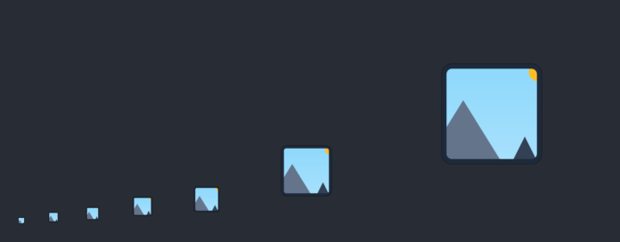

<div align="center">



# Image Viewer

**A fast, native-feeling image viewer for Windows.**

Every decode, thumbnail and full-resolution tile runs on a worker pool —
the UI thread never decodes, so the window only ever paints pixels that
are already in memory.


<p>
  <a href="#quick-start"><b>Quick start</b></a> &nbsp;·&nbsp;
  <a href="#features"><b>Features</b></a> &nbsp;·&nbsp;
  <a href="#shortcuts"><b>Shortcuts</b></a> &nbsp;·&nbsp;
  <a href="#settings"><b>Settings</b></a> &nbsp;·&nbsp;
  <a href="#build"><b>Build from source</b></a> &nbsp;·&nbsp;
  <a href="#license"><b>License</b></a>
</p>

</div>

---

<a name="why"></a>

## ✨ Why this one

- **Instant next / previous.** One decode per image, neighbour preloading,
  and full-resolution tiles that stream in behind a fast preview.
- **Edits that never touch your files.** Turn, mirror and crop as much as
  you like; nothing is written until you press `Ctrl+S`, and that writes a
  *new* file beside the original.
- **Genuinely lossless JPEG editing.** Turns and mirrors are applied to the
  DCT coefficients — the compressed data is moved, not re-encoded.
- **Comics and manga.** `.cbz` / `.zip` / `.7z` / `.rar` open like folders,
  and manga mode pairs pages into turns with right-to-left support.
- **Zero setup.** One exe, no account, no telemetry, no network calls, and
  a per-user file association if you want one.

---

<a name="quick-start"></a>

## 🚀 Quick start

No installer. Build it once, then run it:

```powershell
cargo build --release
target\release\image-viewer.exe C:\photos
```

> **No prebuilt binaries yet.** A release build needs the Rust toolchain and
> the MSVC C++ build tools — see [Build from source](#build).

Point it at a picture, a folder, or a comic:

```
image-viewer.exe C:\photos
image-viewer.exe C:\comics\vol1.cbz
```

Drag a file, folder or archive onto the window to open it. To add the app to
Windows' **Open with** list (per user, no admin rights):

```
image-viewer.exe --register
```

<p>
  <a href="#build"><b>Build instructions &amp; requirements</b></a> &nbsp;·&nbsp;
  <a href="#command-line"><b>All command-line flags</b></a> &nbsp;·&nbsp;
  <a href="#caveats"><b>Known caveats</b></a>
</p>

---

<a name="features"></a>

## 🖼️ Features

### Formats

Detection is by **magic bytes, not extension** — a PNG saved as `.jpg` still
opens correctly.

| Format | Decoder |
|---|---|
| JPEG | `turbojpeg`, with a DCT-scaled fast path for large images |
| PNG, WebP, GIF | `image` crate, including APNG and animated WebP |
| TIFF, BMP, ICO, QOI | `image` crate (multi-page TIFF past page 1 via the `tiff` crate) |
| JPEG XL | `jxl-oxide` |
| HEIC, HEIF, AVIF | `heic` |
| SVG | `resvg`, rendered at the panel's target size |

EXIF orientation is applied on load (JPEG only — the `heic` crate already
applies HEIF container transforms, so applying the tag again would
double-rotate).

<details>
<summary><b>Which formats are deliberately not supported, and why</b></summary>

Not every format the `image` crate can decode is enabled, and the reasons are
worth stating because they are not all "we forgot":

| Skipped | Why |
|---|---|
| Targa (`.tga`) | **No magic bytes at all.** Detection here is by content, so a Targa is unidentifiable — it fails as `Unknown`. Supporting it would mean putting the file extension back into the decode path, which is the one thing this design avoids |
| DDS | Decode-only in the crate, so a fixture cannot be generated with the crate that decodes it — untestable with it. Also a game-texture container |
| OpenEXR, Radiance HDR | Linear-light floating point. Through an 8-bit sRGB surface with no tone mapping they come out washed out and blown out, which is *worse* than refusing: the file is fine and the viewer is wrong, and you cannot tell which |
| PNM (`.pbm`/`.pgm`/`.ppm`/`.pam`), farbfeld | A bitmap-mask family and a format that mostly lives in Rust demos. They would pad the file-association list for no real use |
| AVIF (via `image`) | Already handled, and better, by the `heic` crate, which also reads the container's `colr` box. A second, weaker decoder for a format already covered |

The line is not "can the crate decode it" but "can we display it *correctly*,
and can we still test it". QOI and SVG clear both.

</details>

### Viewing

- Fit-to-window on load, `F` to re-fit, `1` for exactly 1:1
- Zoom with the wheel, pan by dragging; the status bar shows the zoom as a
  percentage of 1:1, so it means the same whatever the window is doing
- Progressive refinement: a cheap preview first, then full-resolution
  **1024 px tiles** streamed in over it, so zooming in never blocks
- Neighbour preloading in both directions
- Animated playback with per-frame delays — GIF, APNG and animated WebP
- **Multi-page TIFF** — `←` / `→` walk the pages of a document before moving
  to the next file, and the position shows in the title bar and status line
  (`page 3/12`). Stepping back from page 1 lands on the **last** page of the
  previous file
- Transparency checkerboard backdrop
- **Rotate ⟲ / ⟳**, **Mirror H / V**, **Reset turn** — quarter turns and
  mirrors, **per image**, re-fitting each time. Turn and mirror *compose*
  rather than living in separate counters, because they do not commute.
  Nothing is written to the file until you save
- **Crop** (`C`) — drag on the image to frame a crop. The frame follows the
  picture if you turn it afterwards, and is snapped to the JPEG block grid so
  the lossless crop lands where it can. Hold `Shift` for a perfect 1:1
  square, or pick a shape (1:1, 16:9, 9:16, 4:3, 3:4, 3:2, 2:3, same as
  image) in Settings → Crop shape
- **Undo** (`Ctrl+Z` / `Ctrl+Shift+Z`) — per-image history for turns, mirrors
  and crops; it never writes to disk
- Folder watcher: new, deleted and re-saved files are picked up immediately
  (OS notifications; a folder that refuses a watch falls back to a 2 s check)

### Gallery grid (`G`)

A scrollable thumbnail grid of everything in the current folder or archive.

- Thumbnails decode lazily, only for cells that are actually visible
- Where the camera wrote an **embedded EXIF thumbnail**, that is used instead
  of decoding the file at all — **16–40× faster** on real JPEGs
- **If you have already browsed the folder in Explorer, its cells come from
  Explorer's own thumbnail cache** — 6–7 ms each against 595–709 ms to decode
  the same photographs. The app only reads that cache; it never asks Windows
  to make a thumbnail
- **Arrows** move a selection, **Enter** opens the highlighted image, and a
  click opens whatever you clicked. Browsing the grid does not change the
  image on screen, so arrowing through a big folder costs no re-decodes
- `Esc` closes the grid

### Filtering (`/`)

Press `/` to focus a filter box and narrow the folder to matching file names —
case-insensitive substring match. `Esc` clears it. The filter applies to **the
whole viewer**, not just the grid: next/previous walk only what is left, so a
filtered folder is a gallery of its own. Single-key shortcuts stand down while
you type.

The filter also understands ratings:

| Query | Matches |
|---|---|
| `stars:4`, `stars:4+` | at least 4 stars |
| `flagged` / `unflagged` | the pick flag |
| `tag:holiday` | case-insensitive substring of the tag list |
| anything else | file-name substring |

The filter is deliberately **not** remembered between sessions. One that
silently survived a restart would hide files with no obvious way back.

### Archives

Opening a `.zip`, `.cbz`, `.7z` or `.rar` extracts the image entries to a temp
folder and opens it as a normal gallery, so paging, zooming and the grid all
work unchanged. The temp folder is reused while the archive is unchanged and
cleaned up on exit and when you step out at either end. Comics are read-only:
delete / move / copy are refused rather than silently writing into the zip.

Archives are also **listed in a folder** alongside images, in every sort mode
and in the grid. Arrow onto one and it *opens* rather than decodes, and
**both** ends step back out:

- `←` at the archive's first page returns to the folder, cursor on the archive
- `→` at its last page *continues* on to the next entry — usually the next
  archive, so a shelf of volumes is one press per volume

Members are flattened: nested folders do not become folders, non-images are
skipped, and two members that would flatten to the same name are counted once.

<details>
<summary><b>Archive format support and limits</b></summary>

- **7z and zip read fully. RAR5 reads only uncompressed members** — the Rust
  RAR reader cannot decompress, so compressed pages are counted as unreadable
  and skipped rather than shown as broken images. RAR4 is not supported and
  says so.
- Archives are extracted to `%TEMP%\image-viewer`, released on leaving and on
  exit.
- `Del` refuses on an archive. So does move/copy.

</details>

### Editing & saving

- **`Ctrl+S`** writes a new file beside the original — `photo.jpg` becomes
  `photo_rotated.jpg`, `photo_cropped.jpg`, or `photo_copy.jpg` when nothing
  changed. The original is never modified, so the action is reversible and
  saving twice accumulates instead of compounding.
- **`Ctrl+Shift+A`** opens *Save as*: choose the file path, format (`.jpg`,
  `.png`, `.webp`, `.bmp`, `.tiff`), JPEG quality and a maximum long side. It
  opens pre-filled with exactly what `Ctrl+S` would write.
- **`Ctrl+C`** copies the picture exactly as you framed it — cropped, turned
  and mirrored — onto the clipboard, with no re-compression.
- **`Ctrl+Shift+S`** saves the same edit at display size.
- PNG, BMP and TIFF are written losslessly; **WebP, GIF, HEIC and JXL are
  refused** with a message rather than re-encoded, because that would be a
  second generation of compression.

<details>
<summary><b>How the lossless JPEG path works, and what it costs</b></summary>

For JPEG the transform is applied to the **DCT coefficients** — the compressed
data itself is moved, not recompressed. Measured on generated images at
quality 90, reported per transform because a mirror is not obviously cheaper
than a turn:

| image | transform | lossless | decode + re-encode | size in → out |
|---|---|---|---|---|
| 1920×1080 | rotated 90° CW | 43 ms | 84 ms | 1.02× |
| 1920×1080 | mirrored left-right | 33 ms | 84 ms | 1.00× |
| 4000×3000 | rotated 90° CW | 212 ms | 466 ms | 1.00× |
| 4000×3000 | mirrored left-right | 166 ms | 466 ms | 1.00× |
| 6000×4000 | rotated 90° CW | 456 ms | 1041 ms | 1.00× |
| 6000×4000 | mirrored left-right | 362 ms | 1041 ms | 1.00× |
| 6000×4000 | transversed | 546 ms | 1041 ms | 1.00× |

All seven transforms are in the same cost class, and about 2.4× faster than
the obvious alternative, because it never fully decompresses. The size column
is the point: a re-encode makes a fresh rate-distortion decision per block and
comes out a different size, while a coefficient transform lands within a
percent.

**A crop and a turn are two passes, not one**, and that is forced rather than
chosen. TurboJPEG reads a crop region in the transform's *destination* space —
the rectangle as it lands after the turn, not before it — and refuses the four
axis-swapping operations outright. So the crop is taken first, with no
rotation, and the turn is applied to the cropped result. Both passes rearrange
coefficients and neither decompresses to pixels, so it is still one generation:

| image | crop | crop + turn | turn only | size ratio |
|---|---|---|---|---|
| 1920×1080 | 31 ms | 39 ms | 54 ms | 1.01× |
| 4000×3000 | 103 ms | 170 ms | 323 ms | 0.99× |
| 6000×4000 | 195 ms | 318 ms | 586 ms | 1.00× |

The ratio is crop-plus-turn output over crop-only output: ~1.00 means the
second pass moved coefficients and left the entropy-coded data alone.

**A rotated JPEG can lose up to one 16 px block off an edge.** Lossless
transforms move whole 8×8 DCT blocks, so a width or height that is not a
multiple of the MCU block size leaves partial blocks that cannot reach the new
edge. Rather than leave a visible strip, the save discards them. This is a
no-op when the dimensions already align, which is the common case.

</details>

### Ratings & metadata

Each image carries three rating attributes: a **star rating (0–5)**, a **pick
flag**, and a **tag list**. They live in an XMP sidecar beside the file —
`photo.jpg` keeps its rating in `photo.jpg.xmp` — so the image bytes are never
touched and the write is atomic.

- The left pane shows `*` buttons and a Flag checkbox; clicking the lit star
  clears back to 0
- `+` / `-` nudge the stars, `B` flips the flag
- Tags are edited by other tools and only read here
- Ratings are refused inside archives, which are read-only
- The filter box understands `stars:`, `flagged` and `tag:` (see above)

<details>
<summary><b>EXIF panel and histogram</b></summary>

The left panel shows camera make, model and lens, capture date, aperture,
shutter speed, ISO, focal length, metering mode, flash, colour space and
orientation. GPS-tagged images also show coordinates and altitude, with a
clickable **Open in Google Maps** link.

Below the file's own data, a **Histogram** section shows per-channel levels
for the picture on screen plus black- and white-clipped pixel counts with
percentages. The levels are counted on the decode worker from the preview
buffer, so the panel draws numbers rather than pixels.

It is read only while that panel is on screen. With the panels hidden — F11,
or `I` — the viewer stops asking for metadata entirely and gives the time back
to the image.

</details>

### Manga mode (beta)

`M` shows images as **turns** — one page, or two meeting at a seam — laid out
the way a book is. A scan that is itself two printed pages takes a whole turn
to itself, and everything after it is re-paired. `D` swaps which side a turn
opens on and which way the arrows go; **it is on by default**.

- The **seam is the middle of the picture**, with no gutter between pages, so
  facing pages touch and a drawing that crosses the fold is unbroken
- Both pages of a turn share **one scale**, so zooming and panning apply to
  the turn and the halves cannot be zoomed apart
- A lone **portrait** page (a cover) hangs off the seam on its own side; a lone
  **spread** fills the window and is centred
- `O` / `Shift+O` change how many pages open alone at the front; `X` overrides
  what the app thinks the current page is
- In manga mode `Home` / `End` go to the first and last **turn**

<details>
<summary><b>Manga mode: what it cannot do, and the two open beta issues</b></summary>

> **Beta.** The pairing, the layout, the keys and full-resolution tiles on both
> halves have been run and checked on real volumes. Two things are open, both
> written up in `TODO.md` with their measurements:
>
> - **1440p-class images can still show moire.** Turning it down is a straight
>   trade against sharpness, and no single setting is right for both
>   photographs and grey screentone — a wider low-pass that helps one makes
>   the other worse. The setting is in the panel (`Smooth`); `Fast` is the
>   default.
> - **Fullscreen (`F11`) has one unreproduced report** of moire appearing on
>   every page and clearing when the mode is toggled.

**Three things this cannot do, so you do not have to find out:**

- **A single landscape page and a scan of two printed pages are geometrically
  identical.** Both are about 1.414 wide, so no aspect-ratio detector can tell
  them apart — every reader in this field has the same problem. What bounds it
  here is the tolerance check: a landscape page will not pair with a portrait
  one, so it takes a turn of its own instead of being squashed into a half.
  `X` ends it: press it on the page and it shares.
- **A folder of 3:2 photographs in manga mode is one photo per turn.** 3:2 is
  1.5, above the 1.2 threshold, so every photograph is read as a two-page
  scan. Manga mode is for pages; leave it off for photographs.
- **The first visit to a cold book can shift the pairing once**, as each page's
  dimensions arrive, and it corrects itself on the second visit.

**Navigation keys move as one unit.** The arrows, `PgUp` / `PgDn` and both
mouse side buttons are all resolved through one rule, so under right-to-left a
rightward press is *backwards* and nothing can disagree with anything else.
The wheel is the one exception and always moves forward.

`O` and `Shift+O` are stored per folder in
`%LOCALAPPDATA%\image-viewer\spreads.json` — a file this app owns, holding
nothing but pairing decisions. **Deleting it clears every override** and goes
back to the detected shapes.

</details>

### Interface

- Browse Folder… / Browse File… dialogs, plus drag-and-drop of a file, folder
  or archive
- **A dropped file is copied** into `%TEMP%\image-viewer\drop\` before it is
  opened, and the copy is deleted when you open something else or quit. This is
  because a drag out of a zip is a *hand-off*: Explorer extracts the member to
  a temp file, gives the viewer that path, and deletes it a moment later
- F11 for fullscreen (hides all chrome), `I` to toggle the panels
- Sort by name (natural order, so `IMG_2` precedes `IMG_10`), date, size or
  random
- Remembers the last image you were on, per folder
- Slideshow with pace and shuffle
- Optional per-user file-type registration
- Portable mode: an empty `portable.txt` beside the exe keeps config, thumbs,
  spreads and wallpaper there

<details>
<summary><b>Why the dropped-file copy exists</b></summary>

Without the copy the picture blanks about a second later, when the folder
watcher notices the file it was showing no longer exists. The status bar says
where the copy went. Nothing else is copied — a file opened from the command
line or the dialog is used where it is.

</details>

<details>
<summary><b>User commands (beta)</b></summary>

> **Beta.** `Ctrl+1`..`Ctrl+9` runs an external program against the picture on
> screen, configured in Settings → User commands. `mspaint.exe` with args
> `{file}` opens the current picture in Paint. Empty args passes the file; no
> quotes needed (there is no shell — quotes would arrive as literal `"`
> characters). Spawns are detached, never waited on, and rate-limited to one a
> second; chords fire on physical presses only, so holding one cannot spawn a
> storm.

> **A hard freeze opening Paint was reported twice and is parked.** Spawning
> itself is exonerated (a `cmd.exe` command runs exactly once, and the same
> file double-clicked in Explorer opens fine), and every freeze came from a
> build predating the repeat and cooldown guards — but it was never confirmed
> fixed on a current build, so the feature stays beta until it is.

</details>

---

<a name="shortcuts"></a>

## ⌨️ Shortcuts

The essentials:

| Key | Action |
|---|---|
| `←` `→` | Previous / next image, or page / manga turn |
| `G` | Gallery grid |
| `F` / `1` | Fit to window / 100% |
| `C` | Crop mode |
| `Ctrl+S` | Save a new file with the edits baked in |
| `Ctrl+C` | Copy as it appears |
| `Del` | Move to the Recycle Bin |
| `/` | Filter |
| `M` | Manga mode |
| `F11` | Fullscreen |

<details>
<summary><b>Every key and mouse action</b></summary>

| Key | Action (shipped default — every row rebindable in Settings → Keys) |
|---|---|
| `←` `→` | Previous / next image, or previous / next **page** of a document (also `PgUp` / `PgDn`) — in **manga mode**, previous / next **turn**, and right-to-left flips the arrows |
| `↑` `↓` | In the grid: move the selection by a row |
| `Enter` | In the grid: open the selected image |
| `Home` / `End` | First / last image (in the grid: first / last cell) |
| `G` | Toggle the gallery grid |
| `F` | Toggle fit-view mode (every image fitted; mutually exclusive with `T`) — also `Space`, which is JPEGView's own Space binding |
| `Shift+F` | Fill window (crop overflow, single image only) |
| `1` | Zoom preset 1 (100% by default; each of `1`–`4` configurable in Settings) |
| `2`-`4` | Zoom presets 2-4 (2x, 4x, 8x by default; one-shot jumps) |
| `T` | Fit window to image as a mode: always 100%, window hugs (clamped to monitor) |
| `,` / `.` | Step the animation one frame back / forward (pauses it, wraps) |
| `K` | Pause / resume the animation |
| `Space` | Toggle 100% (actual size) ↔ fit, like `F` — in the grid: move the selection right |
| `I` | Toggle the side and bottom panels |
| `L` / `P` | Toggle the left (EXIF) / right (settings) pane alone |
| `/` | Focus the filter box |
| `F11` | Fullscreen |
| `Esc` | Clear the filter (if typing) → close the grid → leave fullscreen → close the window (the last step-offable in Settings; `Esc` itself is not rebindable) |
| `C` | Toggle crop mode |
| `+` / `-` | Rating up / down one star (0-5, XMP sidecar) |
| `B` | Flag / unflag the current image (XMP sidecar) |
| `Del` | Move to the Recycle Bin (never a hard delete) |
| `E` `W` `R` | Explore folder, wallpaper, reload folder (`Shift+W`: wallpaper as displayed, crop and turn baked in) |
| `M` | Toggle **double page mode** — show images as turns of one or two pages |
| `D` | Toggle **right-to-left** pages (only while double page mode is on) |
| `O` / `Shift+O` | One fewer / one more page opening alone at the front of the gallery |
| `X` | Toggle the current page between single and double (takes a whole turn to itself) |
| `Ctrl+C` | Copy the image to the clipboard, cropped and turned as it appears (refused on page 2+ of a document) |
| `Ctrl+Shift+C` | Copy the current file's path as text |
| `Ctrl+S` | Save a new file beside the current one, crop and transform baked in losslessly (refused on page 2+ of a document). Named for what it is: `*_rotated`, `*_cropped`, or `*_copy` when nothing changed |
| `Ctrl+Z` / `Ctrl+Shift+Z` | Undo / redo the last turn, mirror or crop. **Per image** — undo means undo on the picture you are looking at |
| `Ctrl+Shift+A` | Save as — pick the file, format, JPEG quality and a maximum long side |
| `Ctrl+Shift+S` | Same edit at display size (`*_screen.jpg`; JPEG is re-encoded, PNG/BMP/TIFF stay lossless) |
| `Ctrl+1`..`Ctrl+9` | Run a user command against the current file (Settings → User commands; `{file}` `{dir}` `{name}` expand) |
| `Ctrl+P` | Print the file on screen through its registered handler (crops/turns not applied) |
| Touch buttons | Set the file date to now, its EXIF date, or the whole visible folder to EXIF dates |
| Copy original | The stored picture EXIF-oriented, no crop or turn (Ctrl+C copies framed) |
| Portable mode | Empty `portable.txt` beside the exe keeps config, thumbs, spreads and wallpaper there |
| Arrow keys / `PgDn` / `PgUp` | Navigate (all rebindable like every other key) |
| Mouse wheel | Zoom — or flip images, if that setting is on (`Ctrl`+wheel always zooms) |
| Mouse side buttons | Same as `←` / `→` (still hardcoded — mouse is not rebindable yet) |
| Drag & drop | Open a file, folder or archive. A dropped **file** is copied to `%TEMP%` first, so it survives the source disappearing |

</details>

---

<a name="settings"></a>

## ⚙️ Settings

<details>
<summary><b>All settings, defaults and what they do</b></summary>

Stored as JSON in `%APPDATA%\image-viewer\config.json`:

| Setting | Default | Meaning |
|---|---|---|
| Load all images in folder | on | Build the queue from the whole folder on startup |
| Linear-light downsampling | on | Resample in linear light instead of gamma space — noticeably cleaner on line art |
| Downscale filter | Hermite | Hermite / Catrom / Lanczos3, applied live |
| Smooth | off | Low-passes a downscaled page harder than the minimum, which hides a dot grid on some pages and costs edge sharpness. **Off by default** — it depends on the page. See the note below |
| Pixel art | off | Magnified drawing samples nearest, so a sprite zoomed past 100% stays squares of its own pixels instead of smearing. Zoomed out, the averaging filter still runs. Applies to the picture, its zoom tiles and animation frames — grid cells stay as they are |
| Convert Display P3 to sRGB | off | See the wide-gamut note below. Off by default because it changes how photos look |
| Cache grid thumbnails on disk | on | Keep decoded grid cells in `%LOCALAPPDATA%\image-viewer\thumbs`, capped at 256 MB |
| Cache previews of large pictures on disk | on | Keep the picture itself in `%LOCALAPPDATA%\image-viewer\previews`, capped at 512 MB |
| Grid cell size | 150 pt | Side of one gallery-grid thumbnail (64–400 pt). Applies live, no re-decode |
| Wait for image when holding arrows | off | Hold-to-browse that never outruns the decoder, so no image is skipped |
| Mouse wheel flips images | off | Wheel pages instead of zooming (`Ctrl`+wheel still zooms) |
| Loop back at folder ends | on | Wrapping past the last image returns to the first |
| Manga mode | off | Show images as turns of one or two pages rather than one at a time. `M` |
| Right-to-left pages | **on** | A turn opens on the right, so `←` reads forwards. `D`. On by default because it is only read while manga mode is |
| Sort mode | Name | Name (natural order) / Date / Size / Random |
| Descending sort | off | Reverse the sort order (Z→A, oldest/smallest first) |
| Slideshow | off, every 3 s | Start/stop button plus pace (1-60 s) and a Shuffle checkbox. Advances until toggled off, or stops at the end with looping off |
| Animation speed | 1× (file timing) | GIF/WebP/APNG playback multiplier, 0.1–8×, live |
| Esc closes the app | on | Esc in crop mode drops the frame first; with this off Esc never quits |
| Worker threads | 0 (auto) | Decode pool size. 0 picks 2-4 from your CPU; 1-8 overrides. Applies on restart |
| Zoom keys 1-4 | 1× toggles 1:1 mode, 2×-8× one-shot jumps (all configurable) |
| Fit view | off | Sticky fit-to-window (`F`); mutually exclusive with `T`. Photos open at 100% with everything off |
| Remember zoom and pan per image | off | An image you zoomed or panned comes back the way you left it while you browse; per page of a document, session-only |
| Show panels | on | Side panels (`I` to hide/show, `L`/`P` per pane). Remembered between launches |
| Allow only one window | on | A second launch exits instead of opening another window. Applies on restart |
| Show archives | on | Lists `.zip`/`.cbz`/`.7z`/`.rar` in a folder beside the images |
| Include subfolders | off | One gallery over the whole tree (sorts apply globally); the watcher covers it too |
| Always on top | off | Keep the window above all others (applies live, kept on restart) |
| Hide title bar | off | No title bar or borders; the window's picture stays in place through the toggle (move with Win+arrows; applies live, kept on restart) |
| Keys | defaults | Click any chord, press replacement keys. Bare letters stay bare, chords stay exact, navigation keeps its direction rule, taken chords show red `also:` markers instead of refusing. `Esc` and mouse buttons are not rebindable |
| User commands | none | External programs run with Ctrl+1..9 against the current file. `{file}` `{dir}` `{name}` expand in program and args; spawned detached, never waited on, rate-limited to one a second |

The downscale filter, **Smooth** and sort mode re-decode immediately; the
linear-light toggle applies to newly decoded images.

**Smooth is off by default because it depends on the page, not because it does
not work.** On a grey tone carrying a dot grid, widening kills the grid's own
beat and at the same time strengthens a longer-period beat that was nearly
invisible. Measured on six 2223x3109 pages at the manga half-panel target:
better on two, unchanged on one, and worse on three. What you get on `main` is
already better on every page, and that comes from the linear-light kernel
prefilter rather than from this toggle. Turn `Smooth` on for a page whose grid
is a single even dot pattern; leave it off for screened pages or the crispest
line art. Edges are noticeably softer with it on — about 1.7x wider on a hard
edge.

</details>

---

<a name="command-line"></a>

## 🔧 Command line

<details>
<summary><b>Flags and environment variables</b></summary>

```
image-viewer.exe [file | folder | archive.zip | archive.cbz | archive.7z | archive.rar]
image-viewer.exe --register      # add this build to the "Open with" list
image-viewer.exe --unregister
image-viewer.exe --icc-scan <folder>   # report the colour space of every image
```

`--icc-scan` prints a tally of what the colour detector found in a folder and
lists the files that need a look, then exits:

```
Colour audit of C:\photos  (1001 images)

  wide gamut              200   displayed without conversion - reads flat
  unknown profile           0   profile could not be read
  non-RGB                   0   not an RGB space
  sRGB                    111
  sRGB (untagged)         641
  not inspected            49   colour lives where this build does not look

Files that need a look (200):
  IMG_0001.heic
  ...
```

It exists because the detector is otherwise only reachable one file at a time
from the metadata panel, and auditing a library meant clicking through it. It
reads every file whole, so it takes a few seconds on a folder of a thousand
images.

`--register` writes a per-user (HKCU) ProgID and `OpenWithProgids` entries for
the extensions the app decodes. It deliberately does **not** claim the
default-handler role — Windows requires the user to confirm that themselves.

Registration includes a `DefaultIcon` pointing at the icon embedded in the exe,
which is what makes Explorer show a picture rather than the generic application
icon. It deliberately does **not** register a `ShellEx\ThumbnailHandler`: the
Windows Imaging Component already supplies real photo thumbnails, and claiming
that key would displace WIC. Explorer caches icons per user, so if nothing
appears to change, run `ie4uinit.exe -show`.

| Variable | Effect |
|---|---|
| `PERF=1` | Turn on the latency report without passing `--perf` a folder |
| `PERF_PHASE=1` | Per-phase timing inside the linear-light resampler (development) |

</details>

---

<a name="internals"></a>

## 🧠 How it stays fast

<details>
<summary><b>Architecture, caches, image-quality notes and measurement</b></summary>

### The pipeline

- **One decode per image.** The file is read and decoded once; the on-screen
  preview is derived from that decode instead of re-reading the file, and the
  full-resolution pixels ride along in the cache for free.
- **Large JPEGs get a DCT-scaled preview** (turbojpeg scales in the DCT
  domain), so opening a 40 MP photo does not mean decoding 40 MP twice. The
  full decode starts only after you have actually looked at it for 120 ms.
- **Big images are resampled in two steps.** A first pass reduces the source to
  at most twice the display size, and only that reduced buffer is converted to
  linear light and filtered — measured at **790 ms → 219 ms** for a 40 MP
  source. That first pass filters in linear light with the same kernel as the
  second, because a plain average aliases *more* than the filter it feeds.
- **Neighbours are preloaded.** A fixed window of 3 images either side of the
  current one, with "next" prioritised slightly over "previous".
- **Previews are sized to your display**, not a fixed cap, so the texture is
  exactly as sharp as the screen can show.
- **Decoding never blocks the UI.** A 2–4 thread worker pool with priorities:
  the image you are looking at first, its neighbours next, grid thumbnails
  last. A job that has started always runs to completion.
- **Nothing gets stranded.** The queue keeps the set of paths the viewer wants,
  so a job superseded while in flight is re-queued rather than dropped.
  Cancelling in-flight decodes looks faster and is not: dropping them was the
  cause of images that silently never loaded.
- **Bounded memory.** Preview cache capped at 16 textures, tile cache at 64
  (≈256 MB), thumbnails LRU-capped at 512, animations at 240 frames /
  256 MB.

### Why the caches exist

**Grid thumbnails.** A grid cell is a 150-point picture of the whole image, and
for most files that means decoding the whole file: a 95 MP scan takes
**700-900 ms** here, and there is no cheaper way to get the whole picture out
of a JPEG. What *is* cheap is decoding it a second time, so cells are cached on
disk. The first visit to a folder is as slow as it always was; every visit
after it is a small file read, about **1 ms** against 67 ms for the same cell
without a cache. Each entry is checked against the file's modification time and
length on every read, so a file edited on disk is re-decoded even if nothing
remembered to invalidate it.

**Previews.** Decoding a large scan is the floor of this viewer: a 28 MB JPEG
takes **690 ms** here before the first pixels. That is fine the first time. It
is not fine for a revisit, a slideshow, or flipping back through a chapter.
Showing one again costs **22-50 ms** instead of 690 — measured, release build,
real photographs. Only large pictures are kept: a small picture is decoded in
one pass that produces the picture *and* the full-resolution version together.
Turning the setting off deletes what it wrote.

The cells' cache and this one are different caches on purpose: a grid cell is
256 px and 13-80 KB, a preview is the size of the window and 1.8-3.2 MB.

### Moire on 1440p photos

Screened or finely-halftoned content can show a moire lattice after being
downscaled. Two things in this build handle it.

The kernel never runs narrower than the pipeline's own minimum
(`MIN_FILTER_SCALE`, not a setting), which is what a downscaled photo needs at
any size. Before it existed the low-pass width **jumped** at one point in the
pipeline: above it, a two-stage resize landed on a wide enough kernel; below
it, a single pass narrowed to whatever the reduction was — **1.333x** for a
2560x1440 photo on a 1920-long panel. Every 1440p photo was below that point,
so every 1440p photo was under-filtered. Measured on a 100-code test pattern at
that size, the over-filter band drops from **51 to 19 codes** and **41 to 11**,
while detail the output *can* represent barely moves.

Images are also resized for the rectangle they are drawn in, so a photo is
resampled once, at the size it will be displayed.

**What is still there.** This reduces the lattice substantially; it does not
remove it. Roughly a third of the original amplitude remains, and the remaining
part is content sitting exactly at the output's limit, which no resampler can
keep and not alias at the same time.

**And one case this cannot fix.** When the window is wider than the photo's own
aspect ratio, the photo is drawn smaller than the texture prepared for it, and
the **graphics card** does that last bit of shrinking. That step cannot be
low-passed here, because the renderer draws with a linear sampler and no
mipmaps. If a photo moirés badly *only* when the window is very wide, that is
what you are looking at.

### Graphics backend

The renderer is **glow** on OpenGL. There is no setting to pick a backend and
nothing to probe, because glow has no backends to choose between.

An earlier version used wgpu and offered DirectX 12, OpenGL or Vulkan. It was
removed after being measured, not on principle:

- **154 MB more memory at idle** — 321 MB against 84 MB for an empty eframe
  window — and **269 ms more** to create a device, for the **same** 76.8 fps
  (interleaved A/B, active console session).
- Its Vulkan backend **access-violates** during adapter enumeration on this
  machine (`0xC0000005`) even though `vulkaninfo` reports a healthy device.
- eframe's default features also compiled the X11 and Wayland platform layers
  and the web screen reader, none of which a Windows-only app runs.

The one way this can fail is a machine with no OpenGL 2.0 context — a
**disconnected RDP session** is the usual cause, because Windows then hands out
the 1.1 software renderer; the app prints `egui_glow requires opengl 2.0+` and
exits rather than showing a window.

### Measuring it

Built in, because the interesting numbers are about what you *see*, not about
how long a decode takes:

```
image-viewer.exe --perf <folder>     # latency report on exit
```

It records time from intent to useful pixels — startup, selection, next/prev,
zoom, pan, gallery open, folder scan, resize — at p50/p95/p99, plus counters
for blank frames, dropped jobs, GPU uploads, decode panics and stalls. A
release build has no console, so the report is written to
`%TEMP%\image-viewer-perf.txt`.

For the pipeline there is a benchmark that drives the loader directly with no
GUI at all:

```
cargo test --release --test bench_browse -- --ignored --nocapture
```

</details>

---

<a name="build"></a>

## 🏗️ Building &amp; testing

<details>
<summary><b>Requirements, build commands and test suites</b></summary>

```
cargo build --release      # the exe users run
cargo test                 # every suite
cargo test --no-fail-fast  # ... without stopping at the first failing target
cargo test --test unit     # one suite; cargo test <name> for one test

cargo test --release --test bench_browse -- --ignored --nocapture   # browsing benchmark
cargo test --release --test bench_resize -- --ignored --nocapture    # decodes per window drag
cargo test --release --test bench_rotate_save -- --ignored --nocapture  # lossless save, size ratio
cargo test --release --test bench_startup -- --ignored --nocapture   # start-up per candidate
cargo test --release --test pathological -- --ignored --nocapture   # 40/60 MP timings
```

Requires the **MSVC toolchain** and **CMake** (turbojpeg builds libjpeg-turbo
from source).

The benchmarks are `#[ignore]`d `cargo test` targets, not `cargo bench`:
`tests/bench.rs` and `tests/bench_variants.rs` do use criterion, but they sit
in `tests/` as ordinary test targets with the default harness, so `cargo bench`
reports "running 0 tests" and prints nothing. Until they are moved to
`benches/` with `harness = false`, the commands above are the benchmarks that
produce numbers.

Every suite is **fixture-free** — each builds the images it needs in a temp
directory — so a fresh clone passes with no setup at all. `test-images/` is
gitignored, and the only things that read it are the two criterion targets,
which want a real large photo and print a message rather than failing, and
`tests/unit.rs::test_gps_decode`, which skips if `geo.jpg` is absent.

`cargo test` stops at the first failing target, so pass `--no-fail-fast` when
you want the whole picture.

</details>

---

<a name="caveats"></a>

## ⚠️ Known caveats

The short version:

- **Wide-gamut photos are not converted by default.** Display P3 is detected
  and shown as-is; turn on *Convert Display P3 to sRGB* in Settings if you want
  the conversion.
- **Multi-page TIFF has three deliberate limits.** Some page colour models are
  refused rather than approximated, `Ctrl+S` only works on page 1, and the grid
  shows one cell per file.
- **Transforms last for the session.** Nothing is written until you save, and
  turn/mirror/crop state is not persisted across restarts.

<details>
<summary><b>Full list, including the less obvious ones</b></summary>

- **Multi-page TIFF: three deliberate limits.** Pages work — arrow keys page
  through a document and the title bar and status line show which one — and
  CMYK pages convert correctly. But: pages in **YCbCr, Lab, palette, CMYK+alpha
  or multiband** are **refused with an error** rather than converted
  approximately, because a wrong page colour is silent; **`Ctrl+S` is refused**
  on any page but the first; and **the grid shows one cell per file** (page 1).
- **ICO needs an RGBA PNG entry or a BMP entry.** Windows writes the large
  sizes as RGBA PNGs and the small ones as BMP, both of which decode. A
  PNG-compressed entry that is *not* RGBA is rejected, which is a limitation of
  the underlying decoder rather than a choice here.
- **Wide-gamut photos are not converted by default.** The colour space is
  *detected* in all cases and shown in the metadata panel, but the pipeline is
  8-bit sRGB end to end, so a Display P3 photo is displayed without conversion
  and reads duller than it should. **Convert Display P3 photos to sRGB** in
  Settings turns the conversion on; it is off by default because it is a
  visible change to your pictures, it is a *downgrade* on a wide-gamut display,
  and colours outside sRGB are clipped to fit, which is lossy. Detection covers
  JPEG, PNG and — through the container's `colr` box — HEIC and AVIF; what is
  **not** read is a HEIF that states its colour with `nclx` parameters instead
  of a profile, and JXL, whose colour lives inside the codestream.
- Toggling **linear-light downsampling** does not re-decode images that are
  already in the preview cache — the filter dropdown does. Restart or move to
  another image for the change to show everywhere.
- The **preview cache keeps a few images either side of the current one**, so
  jumping far away discards the old previews; scrolling back re-decodes.
- **Turning, mirroring and cropping do not touch the file.** Nothing is written
  until **Save transformed…** / `Ctrl+S`, and that writes a new file rather
  than modifying the original.
- **The clipboard carries the edit; the wallpaper does not.** `Ctrl+C` puts the
  picture *as you framed it* on the clipboard. **Set wallpaper** still copies
  the original file, so the desktop shows the photograph as the camera stored
  it.
- **Comics (`.cbz`/`.zip`) are read-only** — triage actions are refused, and
  wallpaper support copies the member out to `%APPDATA%` first.
- Preview texture size follows the window: resizing larger re-decodes so the
  image stays sharp, which briefly costs some CPU.

</details>

---

<a name="license"></a>

## 📄 License

Released under the [MIT License](LICENSE).

---

<div align="center">
<sub>Built with Rust and <a href="https://github.com/emilk/egui">egui/eframe</a> · glow (OpenGL) · no network, no telemetry.</sub>
</div>